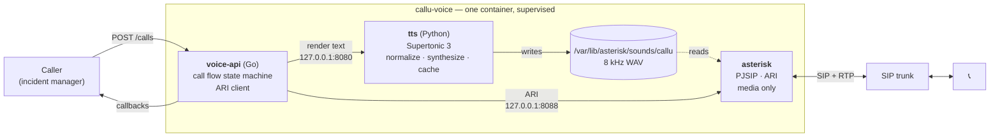
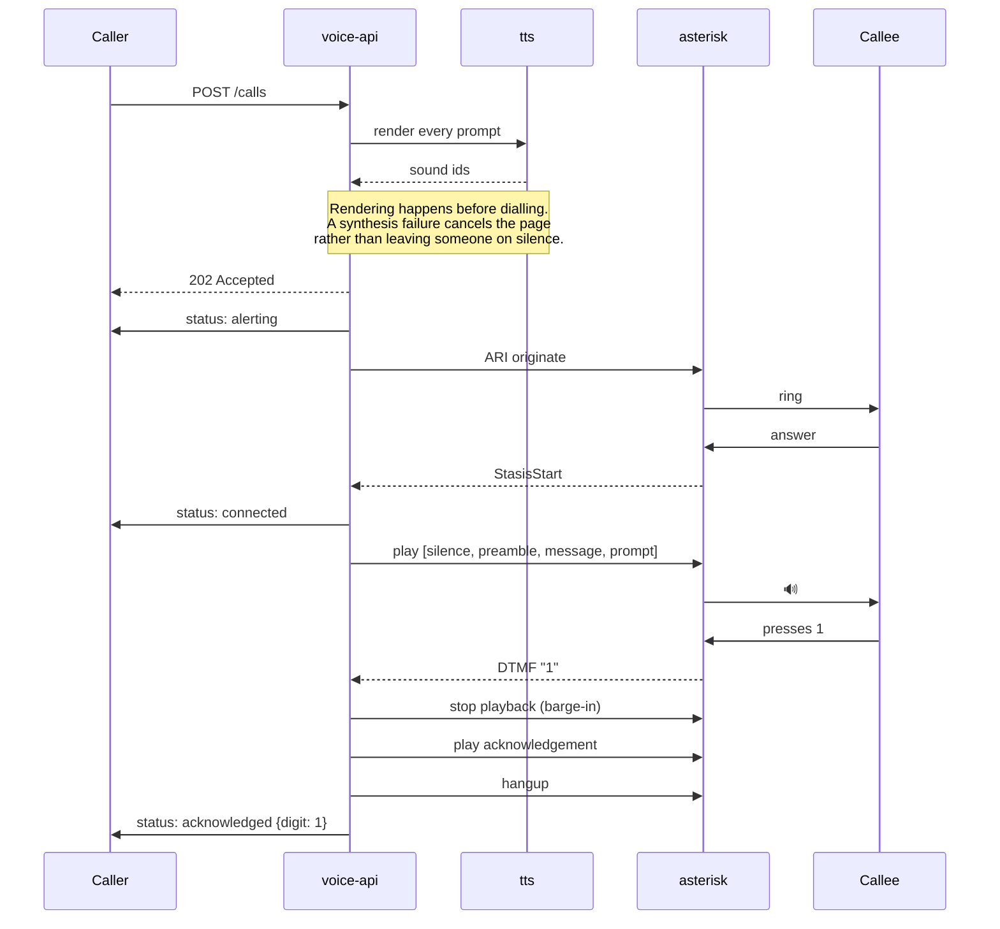
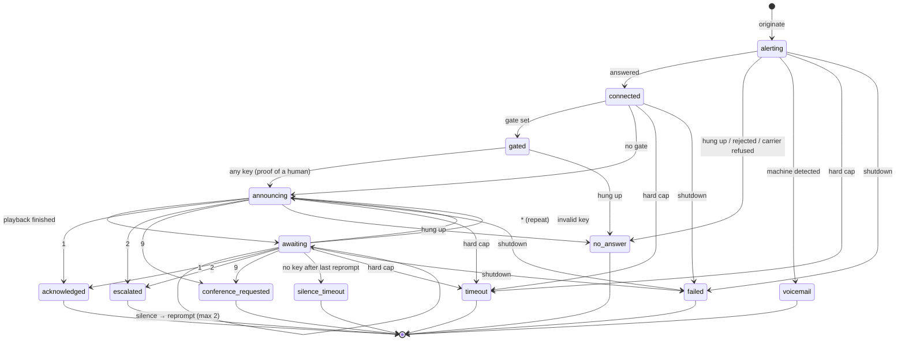
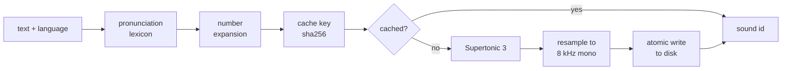

# callu-voice

Self-hosted voice paging for on-call alerting. Places a phone call, reads an
incident aloud, collects a keypress, and reports the outcome back.

Everything runs on your own infrastructure: no cloud telephony account, no audio
or incident text leaving the box. The only outside party is your SIP carrier.

```
POST /calls  ──▶  the on-call engineer's phone rings
                  "Callu notification. payment-api, critical alert.
                   PostgreSQL connection pool exhausted.
                   Press 1 to acknowledge, 2 to escalate..."
                  ──▶  POST {"status": "acknowledged", "data": {"digit": "1"}}
```

---

## Architecture

One container, three processes.



They share a filesystem, so the rendered audio needs no *shared* volume: Asterisk
resolves `sound:` ids against its own disk and has no URL fetcher, and the
synthesizer writes straight into the directory it reads from. It does get a volume
of its own — see [Storage](#storage).

**Three processes, not one, because their appetites differ.** Asterisk's RTP
threads need CPU on a deadline; synthesis saturates every core it is given for
seconds at a time. They are kept apart by scheduling rather than by container
boundaries:

| process | how it is contained |
|---|---|
| `asterisk` | asks for real-time priority (`-p`, SCHED_RR) — but does not get it as shipped, see below |
| `tts` | `nice 10` and capped to `TTS_THREADS` cores (default: all but two) |
| `voice-api` | nothing; it is idle between events |
| all | `supervisord` — a process that dies restarts without taking the others with it; if supervisord ever gives up on one, the container exits so the orchestrator restarts it |

> **Asterisk runs at normal priority, not real-time.** `-p` needs `CAP_SYS_NICE`.
> The image sets `cap_sys_nice+ep` on the binary so a non-root process could use
> it, but both the compose file and the Kubernetes manifest set
> `no-new-privileges` / `allowPrivilegeEscalation: false`, and the kernel ignores
> file capabilities on `execve` under those. So the flag is accepted and silently
> does nothing.
>
> **What it costs:** while a page is being synthesized, Asterisk's media threads
> compete for CPU with the synthesizer, which is audible as choppy or clipped
> audio. `nice 10` plus the `TTS_THREADS` cap is what keeps that acceptable at the
> expected call volume — leave the synthesizer at least two cores.
>
> **`SYS_NICE` is not optional, though.** The file capability makes the kernel refuse
> `execve` outright when `CAP_SYS_NICE` is missing from the container's bounding set,
> so a bare `docker run` with Docker's default capabilities fails with
> `asterisk: Operation not permitted` and never starts. The compose file and the
> manifest both grant it; keep it if you write your own.
>
> **If you need real-time:** remove `no-new-privileges:true` from
> `docker-compose.yml` (or set `allowPrivilegeEscalation: true` in the manifest).
> `cap_add: [SYS_NICE]` is already there, so the file capability then takes effect
> and Asterisk gets SCHED_RR. It also lets any other file-capability or setuid
> binary in the image raise privileges, which is why it is not the default.

---

## The call



### States



`gated` and `announcing` are phases of the call, not reported statuses: the caller sees
`connected` for both. The hard cap starts at origination, not at answer, so `timeout` can end a
call that was still ringing.

`no_answer` is also what a carrier rejection looks like from here — a 403, a 486 Busy or
congestion all arrive as a hangup before answer. `data.cause` carries the carrier's own wording
when it sent one, which is the only way to tell the two apart.

Every terminal status is reported exactly once. A hangup event always arrives
after an acknowledgement; letting it through would re-open a closed incident.

### Why the announcement opens with throwaway audio

Carriers clip the first seconds of a call while the media path settles — long
enough to swallow a service name. Rather than reordering the message to dodge
that, the announcement opens with audio it can afford to lose:

```
 ├── sound:silence/1     Asterisk's own file. Costs nothing.
 ├── "Callu notification."   Disposable. Identifies the caller if it survives.
 ├── "payment-api, critical alert. PostgreSQL connection pool exhausted."
 └── "Press 1 to acknowledge, 2 to escalate, star to repeat, 9 for a conference."
        ▲
        └── safe: ~2s of expendable audio has already absorbed the clipping,
            so the most important words can lead the message.
```

---

## Speech



Synthesis is far too slow to sit on the call path, so **everything is cached**.
Resampling to the telephony band happens in-process: shelling out to ffmpeg would
drag a few hundred megabytes of codecs in to do one job, and piping a WAV out of
it silently yields placeholder RIFF sizes that Asterisk refuses to play.
Static segments — the prompt, the severity labels, the preamble — are rendered
once per language and voice and never again. Only an incident's own title and
description are new, and even those are shared across every page for that
incident: five people re-dialled three times each is one synthesis, not fifteen.

Rules are per-language (`tts/rules/<locale>.json`) and cover eight European
languages. Two passes run before synthesis:

**Pronunciation lexicon.** Respells technical terms for the target language. Not
translation — meaning and identifiers are preserved, only the sounds change. The
product's own name is the clearest case: Turkish reads `c` as /dʒ/, so "Callu"
comes out as "jallu" unless the lexicon spells it out.

| template | tr | de | ru |
|---|---|---|---|
| `Callu` | Kolyuu | Kolju | Колью |

**Number expansion.** Engines mis-read long numbers, and context decides what a
number *is*:

| input | spoken | why |
|---|---|---|
| `after 30 seconds` | after **thirty** seconds | a quantity |
| `HTTP 503` | HTTP **five zero three** | an identifier — "five hundred three" sends an engineer to the wrong place |
| `port 5432` | port **five four three two** | an identifier |

Turkish cardinals are hand-written rather than delegated to `num2words`, which
joins the words together (`beşbindörtyüzotuziki`) — one meaningless token to a
character-level engine.

---

## API

### `POST /calls`

```json
{
  "call_id": "8f3c...",
  "to": "+905321234567",
  "voice": "F1",
  "gate": [
    {"text": "Bir bildiriminiz var. Dinlemek için herhangi bir tuşa basın.", "lang": "tr"}
  ],
  "announcement": [
    {"text": "Callu bildirimi.", "lang": "tr"},
    {"text": "payment-api servisinden acil seviyeli bildirim. PostgreSQL connection pool exhausted.", "lang": "tr"}
  ],
  "prompt": [
    {"text": "Onaylamak için bire, yükseltmek için ikiye, tekrar dinlemek için yıldıza, video konferans için dokuza basın.", "lang": "tr"}
  ],
  "responses": {
    "acknowledged": [{"text": "Anlaşıldı. Olay onaylandı.", "lang": "tr"}],
    "escalated":    [{"text": "Yükseltme işlemi başlatıldı.", "lang": "tr"}],
    "conference":   [{"text": "Video konferans hazırlanıyor.", "lang": "tr"}],
    "invalid_key":  [{"text": "Geçersiz tuş.", "lang": "tr"}]
  },
  "keys":   {"acknowledge": "1", "escalate": "2", "repeat": "*", "conference": "9"},
  "limits": {"max_duration_seconds": 120, "silence_timeout_seconds": 15, "max_reprompts": 2},
  "callback_url": "https://callu.example.com/api/voice/callback"
}
```

`202 Accepted` once the call is on its way, with `{"call_id": "...", "status": "placing"}`.
`"placing"` is the acknowledgement of the request, not a call status — the call statuses are the
ones in the callback table below, and the first of those (`alerting`) follows within moments.

| code | meaning |
|---|---|
| `202` | on its way |
| `400` | the request cannot be spoken: no destination prefix match, a bad key map, an unusable `callback_url`, nothing left to say, or text the synthesizer refused |
| `401` | wrong or missing bearer token |
| `409` | `call_id` already in flight — callers retry pages, and dialling the same person twice is worse than refusing |
| `413` | body over `MAX_REQUEST_BYTES` |
| `502` | the call could not be placed |
| `503` | at capacity, or shutting down |

Nothing was dialled on any of these but `202`, and none of them produce a callback.

**`gate` is optional and worth setting.** It is an incident-free prompt played the moment the call
is answered — "you have a page, press a key to hear it". The announcement waits for that keypress,
so a voicemail machine, which never presses, never records incident detail. Leave it out and the
announcement plays immediately, which is only safe where answering-machine detection is trusted
(`DETECT_MACHINE`, off by default).

**Text is clipped, not refused.** A segment longer than the synthesizer accepts (2000 characters)
is cut rather than rejected: an incident description is data the caller did not compose, and
refusing it would mean nobody is paged. A request carrying more than 32 segments in total is
refused, because dropping segments would silently remove the menu or a confirmation.

Text arrives ready to speak. This service owns *when* to say things, not *what*:
templates, severity labels and language selection stay with the caller.

### Callbacks

Each status is `POST`ed to `callback_url`, with retries.

```json
{"call_id": "8f3c...", "status": "acknowledged", "duration_s": 6.2,
 "data": {"method": "dtmf", "digit": "1"}, "timestamp": "..."}
```

| status | meaning |
|---|---|
| `alerting` | the call has been placed |
| `connected` | the callee answered |
| `acknowledged` `escalated` `conference_requested` | they pressed a key |
| `voicemail` | answering-machine detection fired; nothing was read out |
| `no_answer` | never answered, or hung up without pressing anything |
| `silence_timeout` | answered, but never pressed a key |
| `timeout` | the hard cap ran out |
| `failed` | the call was cut short by a shutdown, mid-page — `data.reason` says which |

A call that could never be placed at all has **no** status: `POST /calls` answers
`502` (or `503` when the service is at capacity or shutting down) and no callback is
ever sent, because the caller has no record of the call yet. So `failed` always means
a human may have been listening — never re-dial on it without the same backoff a
`no_answer` would get.

### `PUT /trunk` and `GET /trunk`

**The only way a carrier gets here.** This service holds none of its own and reads none from its
environment; the caller puts one in place and puts it back after a restart. Both routes take the
same `Authorization: Bearer` token as `POST /calls` — the body carries a SIP password, so there is
no unauthenticated form of either.

```json
{
  "enabled": true,
  "host": "sip.carrier.example",
  "port": 5060,
  "username": "900001",
  "password": "…",
  "auth_username": "",
  "caller_id": "",
  "transport": "udp"
}
```

`{"enabled": false}` is the whole body for *no carrier*, and it is a real instruction: it removes
the trunk objects rather than leaving the previous carrier in place.

What it does: validates the settings, replaces `/etc/asterisk/pjsip_trunk.conf` atomically,
runs `module reload res_pjsip.so`, then asks Asterisk whether the endpoint is actually there —
a module reload reports success while refusing individual objects it could not build. If any of
that fails, the previous file is written back and reloaded, and the response is `500`. A rejected
carrier is `400` and never reaches the file at all.

What it does **not** do: disturb calls that are already up. A PJSIP session holds its own reference
to the endpoint, so replacing the object does not tear down a channel that is ringing or connected —
only the next call dials through the new carrier. It also does not change the transport *objects*:
`protocol` and `bind` are not reloadable in Asterisk, so `[transport-udp]` and `[transport-tcp]` are
declared at boot and `transport` only chooses between them. **There is no TLS transport**, and
`"transport": "tls"` is refused rather than quietly downgraded to plaintext.

Three more fields are accepted but deliberately left out of the body above — `register`,
`dtmf_mode` and `codecs`. A caller that does not state them gets `true`, `auto` and `ulaw,alaw`.
Callu has no field for any of the three and states none of them, so on a panel-managed install
they are always those defaults; setting them by hand over `PUT` holds only until Callu next sends
a carrier.

`GET /trunk` reports the carrier this service last applied over `PUT`, without the password.

```json
{"enabled": true, "host": "sip.carrier.example", "port": 5060, "username": "900001",
 "auth_username": "900001", "caller_id": "900001", "transport": "udp", "register": true,
 "dtmf_mode": "auto", "codecs": "ulaw,alaw", "has_password": true,
 "fingerprint": "b4e4…", "applied_at": "2026-07-30T09:12:44Z"}
```

`fingerprint` is a SHA-256 over the fields the caller stated — `enabled`, `host`, `port`,
`username`, `auth_username`, `caller_id`, `transport`, and the password hashed on its own first.
It exists so the caller can ask "are you still holding the carrier I gave you?" without sending
the password to find out, and answer it from its own record. Two things it deliberately does not
cover: the values this service fills in for what the caller left out, because the caller cannot
know them and would then disagree with us forever; and `register` / `dtmf_mode` / `codecs`, which
the caller does not own. A service that has been given nothing reports the fingerprint of *no
carrier* rather than an empty string, so "none configured" is comparable too.

### `POST /preview` and `GET /preview/audio/{key}`

Renders text without placing a call, so what an announcement will say can be checked before
somebody's phone rings. Same `Authorization: Bearer` token as `POST /calls` — synthesis costs
CPU and the text is incident text.

```json
{"segments": [{"text": "Onaylamak için 1'e basın.", "lang": "tr-TR"}], "voice": "F1"}
```

The response reports what each segment became — `normalized` is the text the synthesizer
actually spoke, which is where a number read in the wrong language shows up without anyone
listening — plus a `key` to fetch the audio under and the duration:

```json
{"segments": [{"key": "0123…", "normalized": "Onaylamak için bire basın.", "duration_s": 2.5}]}
```

`GET /preview/audio/{key}` streams that segment back as WAV (`404` for a key nothing was
rendered under). Rendered segments land in the same cache real calls read, so previewing a
prompt warms it rather than competing with it.

One deliberate asymmetry: a preview is optional and a page is not, so while a call's
announcement is being rendered, `POST /preview` answers `503` with a `Retry-After` instead of
queueing in front of it. Text that is already in the cache plays regardless.

### Reaching the caller back

The callback guard refuses loopback and link-local outright — `CALLBACK_ALLOW_PRIVATE`
does not cover them — so a `callback_url` of `http://127.0.0.1:…` never works, whatever
the deployment. Private ranges are allowed by default, which is what makes the container
route the practical one.

Running it alongside Callu: use **Callu's** compose file, not this one. It carries this
service under the `voice` profile, already on the network the callback needs.

```bash
docker compose --profile voice up -d
```

Then add it in Callu under *Settings -> Communications* as a `callu-voice` provider, with
the callback address `http://callu-api:5095`. Callu's API is not published on the host —
its nginx proxies `/api/*` — so that name only resolves from inside the shared network.

**This is bridged Docker, so read *Audio behind NAT* below before your first real call.**
`network_mode: host` solves the media problem and breaks this one: on host networking the
API is reachable only over the host's own loopback, which the guard blocks. If you need
host networking, Callu has to be reachable on an address that is neither loopback nor
link-local — a LAN address, or a public one behind TLS.

---

## Running it

```bash
cp .env.example .env
# Required, or the container refuses to start:
#   API_TOKEN         the secret callers present on POST /calls   (openssl rand -hex 24)
#   ARI_PASSWORD      internal ARI credential                     (openssl rand -hex 16)
#   ALLOWED_PREFIXES  E.164 prefixes you are willing to dial, e.g. +90
# There is no carrier setting. The container starts without one; Callu sends it over PUT /trunk.
docker compose pull               # published image; `compose build` compiles Asterisk instead
docker compose up -d
curl -s localhost:8090/health     # 503 until Asterisk and the synthesizer are both ready
```

The image is `orchestalabs/callu-voice`, built for `linux/amd64`. Building it yourself works and is
the same recipe, but it compiles Asterisk from source and takes the better part of an hour.

Compose reports one missing required variable per attempt, so expect a couple of rounds if you
skipped some.

`/health` answers with a key per dependency — `ari`, `tts` and `trunk`:

```json
{"status": "ok", "active_calls": 0,
 "checks": {"ari": "ok", "tts": "ok", "trunk": "online"}}
```

`trunk` is reported separately because it answers a different question: Asterisk can be perfectly
healthy while the carrier has stopped taking your calls, and a service that says `ok` through that
is worse than one that is honestly down. It reads the PJSIP endpoint named by `ENDPOINT_FORMAT`
(the part after `@`), reports `unconfigured` while there is no carrier, `unknown` once one has
been applied but nothing has been read back yet, and `unwatched` when the format names no endpoint
at all. A container with no carrier is a normal state, not a fault, so it does not answer 503 on
that alone.

Two limits, stated plainly. It only turns 503 once the endpoint has been seen `online` and then
stopped being so — an endpoint reads `offline` until its first qualify completes, and failing on
that would make every cold start look like an outage. And a qualifying endpoint is not a promise:
it answers OPTIONS, which is not the same as accepting a call. Registration state is not visible
over ARI at all.

Changing the carrier deletes the endpoint the reading came from, and no event ever arrives for an
object that no longer exists. So an `online` reading that can no longer be confirmed is dropped to
`unknown` rather than left standing — which turns 503 for a trunk that *had* been up, and stays
`ok` for one that never was.

`PUT /trunk` is what tells the health check which of those it is looking at. Removing the carrier
(`{"enabled": false}`) is an instruction, not a failure: the reading resets and `trunk` reads
`unconfigured` without answering 503. Putting a carrier back resets it too, because the endpoint
built for the new carrier is a new object and the previous one's history says nothing about it —
so it gets the same cold-start grace any other first qualify does.

`ALLOWED_PREFIXES` fails closed: empty means every call is rejected. That is
deliberate — this endpoint dials the PSTN on your trunk, and an open one is
someone else's phone bill.

Without a carrier, set `TEST_ENDPOINTS=true` and point `ENDPOINT_FORMAT` at a
softphone: the entire flow can be driven end to end without a trunk.

```bash
docker compose exec voice supervisorctl status
docker compose exec voice asterisk -rx "pjsip show endpoints"
docker compose exec voice asterisk -rx "ari show apps"

# Restart one process without recycling the container.
docker compose exec voice supervisorctl restart tts
```

### The carrier: Callu owns it, this container does not

This container starts with **no carrier**, every time. `entrypoint.sh` writes an empty
`/etc/asterisk/pjsip_trunk.conf` — which `pjsip.conf` `#include`s — and there is no environment
variable that puts one there. `PUT /trunk` replaces that file at runtime, and it is the only way.

Nothing about the carrier is kept across a restart, deliberately. It is not on a volume and there
is no state file: a rendered config that outlives the process that wrote it is a second source of
truth, and the one thing worse than not knowing which carrier is live is having two places that
each think they know.

What makes that safe is that the caller reconciles. Callu compares `GET /trunk`'s `fingerprint`
against the carrier it holds every few minutes, and sends it again when they differ — so a
restart, a `compose up` after an image bump, or a rollout heals itself without anyone noticing,
and the log says plainly when a carrier had to be restored. Between the container coming up and
the next sweep there is a window in which it cannot place a call; `/health` reports the trunk as
`unconfigured` through it.

**One voice service holds one carrier.** Two Callu providers pointing at the same base URL with
different trunks is not a primary and a backup — it is two owners of one carrier, and each sweep
would replace the other's. Callu refuses that configuration when it is saved, and reconciles a
pre-existing one from a single provider rather than flipping between them.

To remove a carrier, remove it in Callu — unlink the SIP trunk from the provider, or switch the
trunk row off. Recreating the container is not how a carrier is set, changed, removed, or how a
SIP password is rotated.

### Storage

Two volumes, both declared in `docker-compose.yml` (and as PVCs in `deploy/`):

| volume | mount | what it holds |
|---|---|---|
| `models` | `/cache` | the TTS model weights (~400MB), downloaded on first run |
| `sounds` | `/var/lib/asterisk/sounds/callu` | rendered 8 kHz WAVs, one per distinct segment |

`sounds` is not just about durability. Every incident's own title and description
is a new cache key, so on the container's writable layer the directory grows
without limit — and a full filesystem means *every* page fails on the write, not
just the new one. Two things bound it:

- `TTS_CACHE_MAX_BYTES` (default 2 GB, `0` disables) — an LRU sweep runs after each
  write and evicts down to 80% of it, oldest-accessed first. **Keep it under the
  volume's real size**, because the sweep only runs after a successful write.
- `GET /health` on the synthesizer reports `cached_bytes` and `cache_max_bytes`, so
  how full it is can be watched rather than discovered.

Keeping the volume across a container recreate is worth it on its own: a cold cache
means the next page waits on synthesis before the phone rings.

### Audio behind NAT

Bridged Docker is NAT. Without `EXTERNAL_MEDIA_ADDRESS`, Asterisk advertises its
container address in SDP, the call connects, and nobody hears anything. Set it to
the address the carrier actually reaches. On a Linux host, `network_mode: host`
sidesteps the problem entirely.

The published RTP range must match `RTP_START`/`RTP_END` exactly.

---

## Tests

```bash
docker compose exec -w /srv/tts voice python -m pytest tests/ -q
cd voice-api && go test ./...
```

The call flow is tested against fake ports — no Asterisk, no synthesizer. That is
what the interfaces in `internal/voice` are for: acknowledgement, barge-in,
reprompting, machine detection and the hard cap are all exercised without a PBX.

## Layout

```
Dockerfile        Builds all three into one image.
supervisord.conf  What runs, at what priority.
entrypoint.sh     Renders Asterisk's config from templates, so no credential is
                  baked into the image.
asterisk/etc/     Config templates.
tts/              Synthesis, normalization, cache. The engine sits behind an
                  interface; swapping Supertonic for a cloud voice is one class.
voice-api/        The call flow. internal/call knows nothing about Asterisk;
                  every ARI detail is confined to internal/telephony.
deploy/           Kubernetes: one Deployment, one Pod, one container. It uses
                  hostNetwork for RTP, which puts the call API on the node's own
                  IP — read the exposure notes in the manifest before applying it.
```

## License

MIT — see [LICENSE](LICENSE).

The code here is MIT. The container image it builds also contains **Asterisk,
which is GPLv2** — used unmodified, downloaded from the official upstream URL at
build time and pinned by SHA-256. callu-voice is a separate program that talks to
it over ARI, which Asterisk's own license explicitly permits.

The **TTS model weights are OpenRAIL-M and are deliberately not shipped** — in the
repo or in the image. They are downloaded at runtime, so operators get them
directly from upstream and no use restrictions are passed through us. Do not bake
them into the image.

Full third-party inventory, the Asterisk source pin, and the GPLv2 written offer:
[NOTICE](NOTICE).
